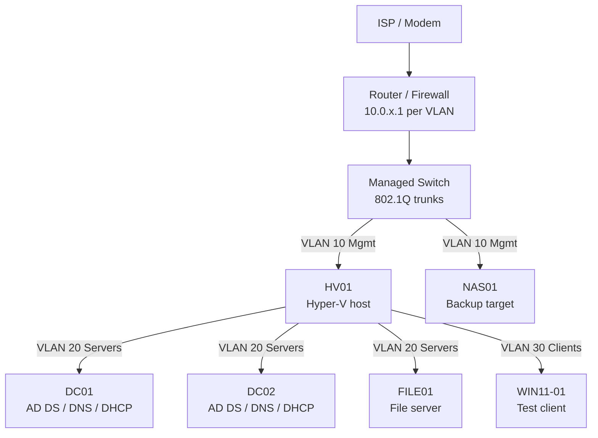

# Homelab

A Windows Server homelab for learning Active Directory, Hyper-V, and infrastructure automation with PowerShell. This repo is the source of truth for **how it is built, how to operate it, and what has changed.**

> **Using this as a template?** Everything in `<ANGLE_BRACKETS>` or marked *(example)* is a placeholder. Search the repo for `<` and `(example)` and replace each one with your real values. See [Placeholder checklist](#placeholder-checklist).

---

## Hardware

| Device | Role | CPU / RAM / Storage | OS |
|---|---|---|---|
| HV01 | Hyper-V host | `<CPU>` / `<RAM>` GB / `<OS DISK>` + `<VM DISK>` | Windows Server 2022 Datacenter *(example)* |
| NAS01 | Backup target | `<CPU>` / `<RAM>` GB / `<CAPACITY>` TB | `<NAS OS>` |
| Router / Firewall | Routing, VLANs, DHCP relay | `<MODEL>` | `<FIRMWARE>` |
| Managed switch | VLAN trunking | `<MODEL>` | `<FIRMWARE>` |
| UPS | Power protection | `<MODEL>` | n/a |

## Architecture

More detail: [Network topology](docs/network/topology.md) · [IP plan](docs/network/ip-plan.md)

## Services

| Service | Host(s) | Notes |
|---|---|---|
| Active Directory Domain Services | DC01, DC02 | Domain: `lab.example.com` *(example)*, NetBIOS: `LAB` |
| DNS | DC01, DC02 | AD-integrated zones, forwarders to `<UPSTREAM DNS>` |
| DHCP | DC01, DC02 | Failover pair (hot standby) |
| Group Policy | DC01 | Baseline GPOs, see [Group Policy](docs/services/group-policy.md) |
| File services | FILE01 | SMB shares, NTFS permissions via AGDLP |
| Backup | HV01, DC01, FILE01 | Windows Server Backup to NAS01 |
| Virtualization | HV01 | Hyper-V (or QEMU/KVM on Linux, see [docs/qemu](docs/qemu/README.md)) |

## Documentation

**Servers**
- [HV01 (Hyper-V host)](docs/servers/hyperv-host01.md)
- [DC01](docs/servers/dc01.md) · [DC02](docs/servers/dc02.md)
- [FILE01](docs/servers/file01.md)

**Services**
- [Active Directory](docs/services/active-directory.md)
- [DNS and DHCP](docs/services/dns-dhcp.md)
- [Group Policy](docs/services/group-policy.md)
- [Backup](docs/services/backup.md)

**Running on QEMU/KVM instead of Hyper-V**
- [Overview and quick start](docs/qemu/README.md)
- [Host setup](docs/qemu/host-setup.md) · [Networking](docs/qemu/networking.md) · [VMs](docs/qemu/vms.md) · [Operations](docs/qemu/operations.md) · [Troubleshooting](docs/qemu/troubleshooting.md)

**Runbooks**
- [Add a new user](docs/runbooks/add-new-user.md)
- [Build a new VM](docs/runbooks/new-vm.md)
- [Patch cycle](docs/runbooks/patch-cycle.md)
- [Restore from backup](docs/runbooks/restore-from-backup.md)

## Scripts

PowerShell scripts are in [`scripts/powershell/`](scripts/powershell/). Run them from an elevated PowerShell session on a domain-joined admin machine or DC. Bash scripts for the QEMU/KVM variant are in [`scripts/qemu/`](scripts/qemu/).

| Script | Purpose |
|---|---|
| `Export-LabConfig.ps1` | Exports DHCP, DNS, AD, GPO, and role configuration into `configs/` for committing |
| `New-LabUser.ps1` | Creates a standardised AD user with a random temporary password |
| `Get-LabHealth.ps1` | Quick health check: reachability, key services, disk space, replication, VM state |
| `qemu/lab.sh` | Create, start, stop, and snapshot the VMs when running on QEMU/KVM |
| `qemu/net.sh` | Create the bridges, tap devices, and NAT for the QEMU lab network |

## Conventions

- **Hostnames:** `<ROLE><NN>`, e.g. `DC01`, `FILE01`, `HV01`
- **Admin accounts:** separate `adm-<username>` accounts for administration. Never use a daily account for admin work.
- **GPO names:** `GPO-<Scope>-<Purpose>`, e.g. `GPO-Servers-Baseline`
- **Groups:** `GG-<Dept>` (global), `DL-<Resource>-<Perm>` (domain local), see [Active Directory](docs/services/active-directory.md)
- **Commits:** short and specific, e.g. `docs: add DHCP failover notes`, `scripts: fix OU path in New-LabUser`
- **Every change** gets a dated line in [CHANGELOG.md](CHANGELOG.md)

## Roadmap

- [x] Hyper-V host
- [x] First domain controller (DC01)
- [x] Second domain controller (DC02)
- [x] File server (FILE01)
- [x] DHCP failover
- [ ] Windows Server Backup to NAS01, tested restore
- [ ] Internal certificate authority (AD CS)
- [ ] WSUS or Azure Update Manager for patching
- [ ] Windows Admin Center
- [ ] Join a Windows 11 client and a Linux VM to the domain
- [ ] Desired State Configuration or Ansible for server baselines
- [ ] Test the QEMU/KVM variant end to end on a real host and fix the docs to match

## Security

This repo is for documentation, not secrets. **Never commit** passwords, product keys, tokens, VPN configs, certificates with private keys (`.pfx`), password manager databases, or unreviewed GPO backups. The [`.gitignore`](.gitignore) blocks the common ones, but it is a safety net, not a substitute for checking `git diff` before every commit.

Keep the repo **private** until you have audited it. If it becomes public, replace real domain names and public IPs with placeholders.

## Placeholder checklist

- [ ] Domain name (`lab.example.com`) and NetBIOS name (`LAB`)
- [ ] IP ranges and VLAN IDs in [IP plan](docs/network/ip-plan.md)
- [ ] Hardware table above and in [hyperv-host01.md](docs/servers/hyperv-host01.md)
- [ ] NAS hostname and backup share path in [backup.md](docs/services/backup.md)
- [ ] `$LabHosts` list at the top of `Get-LabHealth.ps1`
- [ ] `$DefaultOU` and `$DefaultDomain` in `New-LabUser.ps1`
- [ ] Delete anything that does not apply to your lab
