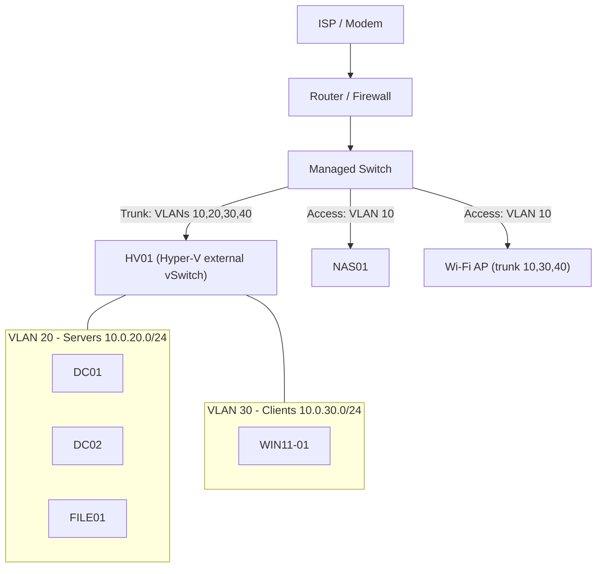

# Network Topology

## Diagram



## VLANs

| VLAN ID | Name | Subnet | Gateway | Purpose |
|---|---|---|---|---|
| 10 | Management | 10.0.10.0/24 | 10.0.10.1 | Hypervisor management, switch/AP/NAS admin interfaces |
| 20 | Servers | 10.0.20.0/24 | 10.0.20.1 | Domain controllers, file server, member servers (static IPs) |
| 30 | Clients | 10.0.30.0/24 | 10.0.30.1 | Workstations and test clients (DHCP) |
| 40 | Guest / IoT | 10.0.40.0/24 | 10.0.40.1 | Isolated, internet only |

*(All values are examples. Replace with your own.)*

## Inter-VLAN firewall policy

Default is **deny**. Allowed flows:

| From | To | Allowed | Why |
|---|---|---|---|
| Clients (30) | Servers (20) | DNS 53, Kerberos 88, LDAP 389, LDAPS 636, Global Catalog 3268/3269, SMB 445, RPC 135 + dynamic 49152-65535, NTP 123 | Domain join, logon, file access |
| Servers (20) | Servers (20) | Any | AD replication, management |
| Servers (20) | NAS01 (10) | SMB 445 | Backups |
| Management (10) | Servers (20), Clients (30) | RDP 3389, WinRM 5985/5986, SMB 445 | Administration |
| Admin workstation | Management (10) | HTTPS 443, SSH 22 | Admin interfaces |
| Guest (40) | Internal VLANs | **Denied** | Isolation |
| All | Internet | HTTP/HTTPS/DNS/NTP | Updates, browsing |

## DHCP relay

Clients (VLAN 30) get addresses from the DHCP failover pair on DC01/DC02 in VLAN 20. The router/firewall must have an **IP helper / DHCP relay** configured on the VLAN 30 interface pointing at **both** `10.0.20.10` and `10.0.20.11`. Without it, clients will not receive leases.

## DNS flow

```
Client -> DC01 / DC02 (AD-integrated DNS) -> forwarders (<UPSTREAM DNS>) -> internet
```

Clients and servers use **only** the domain controllers for DNS. Never point domain-joined machines at the router or a public resolver, since that breaks AD lookups.

## Switch port map

| Port | Connected to | Mode | VLANs |
|---|---|---|---|
| 1 | Router / firewall | Trunk | 10, 20, 30, 40 |
| 2 | HV01 NIC 1 | Trunk | 10, 20, 30 |
| 3 | NAS01 | Access | 10 |
| 4 | Wi-Fi AP | Trunk | 10 (native), 30, 40 |
| 5 | Admin workstation | Access | 10 |

## Notes

- Hyper-V external vSwitch on HV01 is shared with the management OS. VM NICs are tagged with their VLAN ID in VM settings.
- Update this page whenever a VLAN, firewall rule, or switch port changes, and log it in the [CHANGELOG](../../CHANGELOG.md).

**Last reviewed:** 2026-11-03
