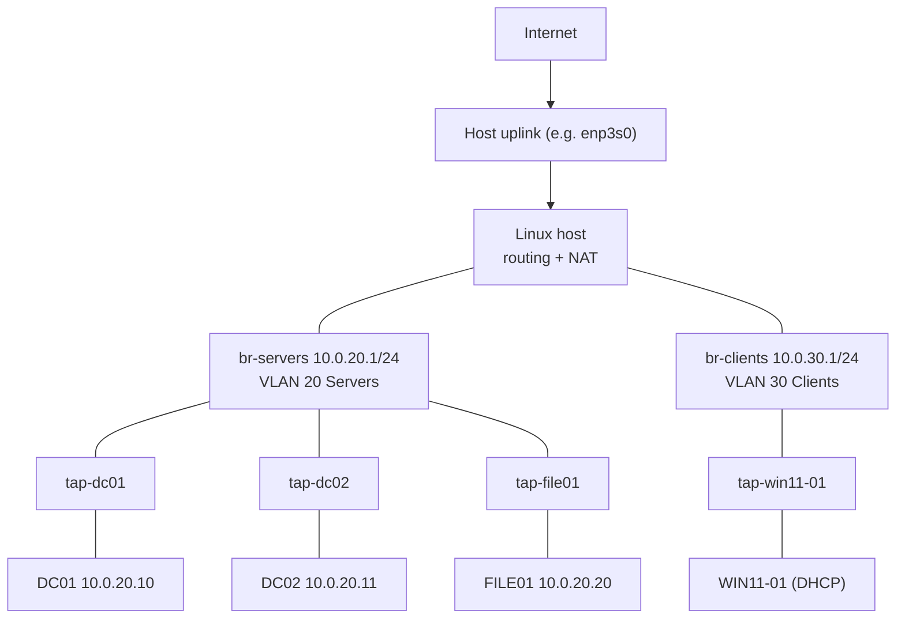

# QEMU Networking

The VLAN design in [topology.md](../network/topology.md) is kept. In QEMU, each **VLAN is a Linux bridge**, each **VM NIC is a tap device** attached to its bridge, and the **Linux host is the router** between them and to the internet.

## Design



Because each VLAN is its own bridge, there are **no 802.1Q tags** inside the lab. The separation is at layer 2, and traffic between bridges has to go through the host, where it is routed (and optionally filtered).

## What `net.sh up` does

```bash
sudo ./net.sh up
```

| Step | Command it runs (simplified) |
|---|---|
| Create each bridge in `BRIDGES` with its `.1` address | `ip link add br-servers type bridge` + `ip addr add 10.0.20.1/24 dev br-servers` |
| Create one tap per VM, owned by your user | `ip tuntap add dev tap-dc01 mode tap user <you>` |
| Attach each tap to its VM's bridge | `ip link set tap-dc01 master br-servers` |
| Turn on IPv4 forwarding | `sysctl -w net.ipv4.ip_forward=1` |
| Masquerade lab traffic out of the uplink | nftables table `lab_nat` |

It is safe to re-run. Remove everything with `sudo ./net.sh down`. Check with `./net.sh status`.

Nothing here persists across reboots by itself. Run `net.sh up` again after boot, or use the [systemd unit](operations.md#start-the-lab-at-boot).

## Addressing

Unchanged from the [IP plan](../network/ip-plan.md). The host's bridge addresses are the **gateways** (`.1`) the VMs use.

### MAC addresses

Each VM gets a fixed MAC so DHCP reservations and Windows network profiles stay stable.

| Pattern | `52:54:00:<VLAN>:00:<last IP octet>` |
|---|---|
| DC01 | `52:54:00:20:00:10` |
| DC02 | `52:54:00:20:00:11` |
| FILE01 | `52:54:00:20:00:20` |
| WIN11-01 | `52:54:00:30:00:20` |

`52:54:00` is the conventional QEMU prefix. Keep each MAC unique across the lab.

## DNS

Unchanged. Guests use the DCs (`10.0.20.10`, `10.0.20.11`) for DNS, and the DCs forward to your upstream resolver. The upstream reaches the internet through the host's NAT.

## DHCP for the Clients VLAN

DHCP is served by DC01/DC02 on the Servers VLAN, but clients are on a different bridge, so DHCP broadcasts do not reach the DCs by themselves. You need a **DHCP relay** on the host's `br-clients` interface. Pick one:

| Option | How | Trade-off |
|---|---|---|
| **A. Relay on the host** | Run `dhcrelay` from ISC DHCP | Simple, but ISC DHCP is end-of-life upstream. It is still packaged on many distros (`isc-dhcp-relay` on Debian/Ubuntu), so check yours. |
| **B. Router VM** | Run OPNsense or pfSense as a VM between the bridges, with DHCP relay and a real firewall | Closest match to the topology doc, more to build |
| **C. Same bridge while learning** | Put the test client on `br-servers` | No relay needed, but it skips the routed-VLAN part of the lab |

### Option A: relay on the host

```bash
sudo apt install isc-dhcp-relay        # Debian/Ubuntu; package name differs on other distros
sudo dhcrelay -4 -d -id br-clients -iu br-servers 10.0.20.10 10.0.20.11
```

`-id` is the downstream interface (clients), `-iu` the upstream (servers). The relay stamps the client's subnet into the request, which is how the DHCP server picks the `10.0.30.0` scope. Run it in the foreground with `-d` first to watch requests, then make it permanent through your distro's service configuration.

Verify from the client: `ipconfig /renew` should give an address in `10.0.30.100-199`.

## Optional: restrict Clients to Servers

By default the host forwards everything between bridges. To enforce the policy in [topology.md](../network/topology.md#inter-vlan-firewall-policy), add this **after** the lab works (save as `/etc/nftables-lab.conf`, load with `sudo nft -f /etc/nftables-lab.conf`). It only touches traffic from `br-clients` to `br-servers` and leaves the rest of the host's rules alone.

```
table inet lab_fw {
    chain forward {
        type filter hook forward priority filter; policy accept;
        iifname "br-clients" oifname "br-servers" ct state established,related accept
        iifname "br-clients" oifname "br-servers" jump clients_to_servers
    }
    chain clients_to_servers {
        meta l4proto icmp accept
        tcp dport { 53, 88, 135, 389, 445, 464, 636, 3268, 3269, 49152-65535 } accept
        udp dport { 53, 88, 123, 389, 464 } accept
        drop
    }
}
```

This is a starting point and has not been tested against a full domain join. If a client cannot join, log dropped packets (`log prefix "lab-drop " drop`) and read `journalctl -k`.

## Reaching the lab from elsewhere

- **From the host:** the host has `10.0.20.1` and `10.0.30.1`, so it can reach every VM directly (RDP, WinRM, and so on).
- **From other machines on your LAN:** add a route on your LAN router for `10.0.0.0/16` via the host's LAN IP, or just RDP/VNC through the host with an SSH tunnel.
- **The NAS (management VLAN):** the lab bridges are NATed out through the uplink, so a NAS on your home LAN is reachable by its LAN IP, and backups to `\\NAS01\backups` work without a management bridge.

## Verify

```bash
./net.sh status
bridge link                                  # shows each tap attached to the right bridge
ip -brief addr show br-servers br-clients
sysctl net.ipv4.ip_forward                   # = 1
sudo nft list table ip lab_nat
```

From a started VM:

```powershell
ping 10.0.20.1                              # the host answers ICMP on its bridge address
Test-NetConnection 10.0.20.10 -Port 445     # reach another VM (Windows Firewall often blocks ping)
Resolve-DnsName example.com                 # DNS through the DCs and the host's NAT
```
